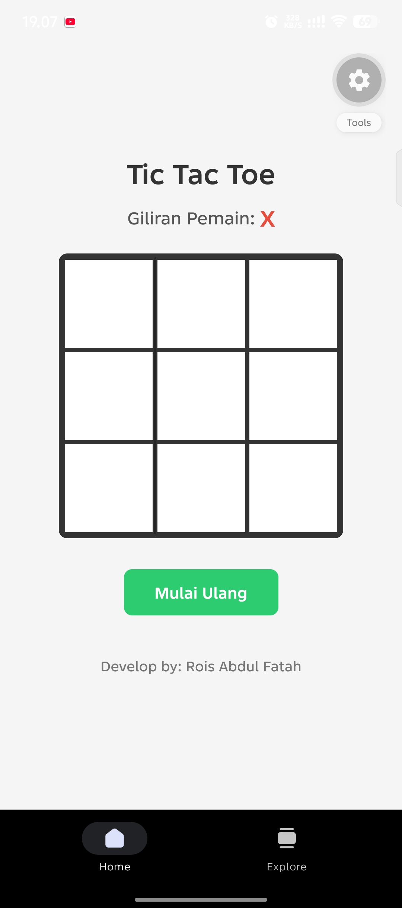
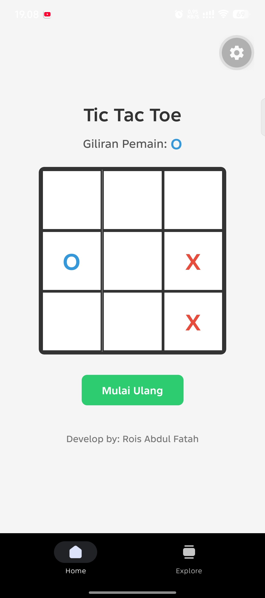
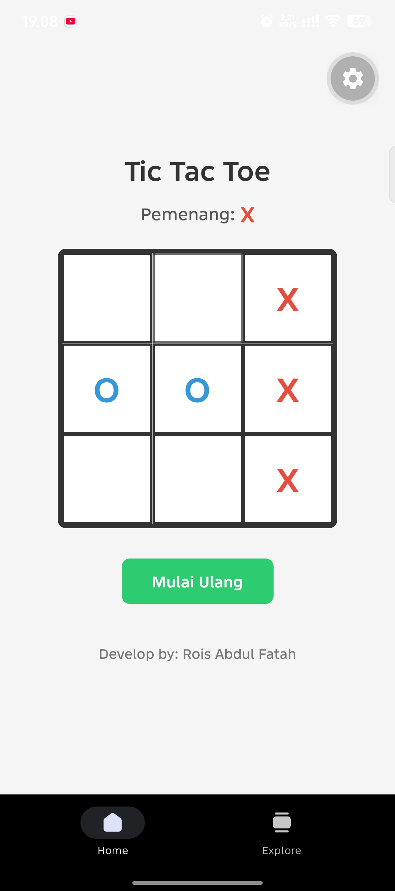
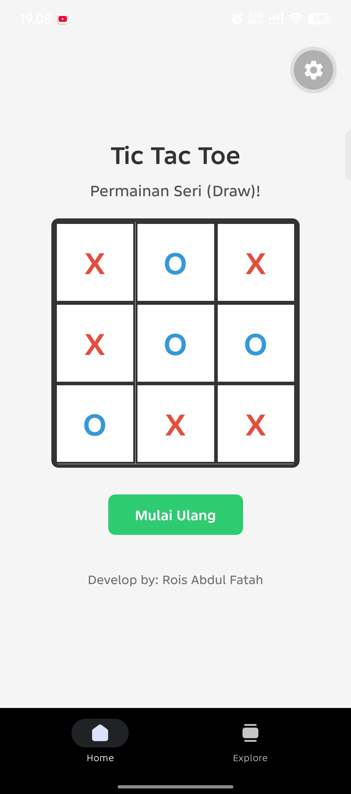

# TicTacToeApp

Aplikasi permainan Tic Tac Toe dua pemain (X dan O), dibuat memakai React Native dan Expo dengan TypeScript.

## Pembuat

- Nama        : Rois Abdul Fatah
- NIM         : 41155050240006
- Mata Kuliah : Mobile Programming
- Prodi       : Teknik Informatika

## Fitur

- **Papan 3x3**: sembilan kotak yang bisa ditekan secara bergantian oleh pemain X dan O
- **Indikator giliran**: menampilkan pemain yang sedang jalan, dengan warna berbeda (merah untuk X, biru untuk O)
- **Deteksi pemenang**: mengecek 8 kemungkinan garis kemenangan (baris, kolom, dan diagonal)
- **Deteksi seri**: menampilkan status seri jika papan penuh tanpa pemenang
- **Mulai Ulang**: mengembalikan papan ke kondisi awal

## Teknologi

- React Native
- Expo
- TypeScript
- React Hooks (`useState`)

## Konsep yang Dipelajari

- **State management**: `useState` untuk menyimpan papan dan giliran pemain
- **Event handling**: menangani sentuhan pengguna pada setiap kotak
- **Immutability**: membuat salinan array (`[...board]`) sebelum mengubah state
- **Flexbox**: menyusun papan 3x3 dengan `flexDirection`, `alignItems`, dan `justifyContent`

## Struktur Project

```
TicTacToeApp/
├── src/
│   └── app/
│       └── index.tsx    # kode utama permainan
├── assets/
├── app.json
├── package.json
└── tsconfig.json
```

## Cara Menjalankan

1. Clone repository:
   ```bash
   git clone https://github.com/RoisAbdulFatah/TicTacToeApp.git
   cd TicTacToeApp
   ```

2. Install dependensi:
   ```bash
   npm install
   ```

3. Jalankan aplikasi:
   ```bash
   npx expo start
   ```

4. Scan QR code memakai aplikasi **Expo Go** di HP (HP dan PC harus satu jaringan Wi-Fi).

## Screenshot

### Tampilan Awal


### Saat Permainan Berlangsung


### Pemenang


### Draw

